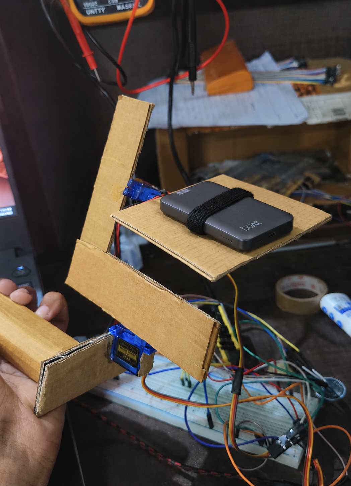

# ESP32 Two-Axis Self-Balancing Platform

A self-balancing platform built using an ESP32, an MPU6500 inertial measurement unit (IMU), and two servo motors. The project explores sensor fusion, feedback control, and real-time embedded programming.

## Overview

The platform uses real-time orientation estimates to adjust two servo motors and counteract tilting along two axes.

The ESP32 reads accelerometer and gyroscope data from the MPU6500, combines them using a complementary filter, and calculates corrective servo commands using a proportional-derivative (PD) controller.

This project was developed as a hands-on exploration of embedded systems and control engineering.

## Features

- Two-axis tilt sensing using an MPU6500 IMU
- Gyroscope bias calibration during startup
- Complementary filtering for orientation estimation
- PD feedback control for both axes
- Independent controller gains for each axis
- Real-time monitoring through the Arduino Serial Plotter

## Hardware

- ESP32 development board
- MPU6500 IMU module
- Two servo motors
- Breadboard and jumper wires
- Mechanical platform and mounting hardware
- Appropriate power supply for the servos and ESP32

## Software and Libraries

- Arduino framework
- MPU6500-DMP library
- Wire library
- ESP32Servo library

## 📸 Project Gallery

### Self-Balancing Platform

### 🎥 Demonstration and Explanation

The video demonstrates the platform's self-balancing behaviour and explains the hardware and control system.

**Video file:** [`videos/balancing_demo.mp4`](videos/balancing_demo.mp4)

## How It Works

### 1. Sensor Acquisition

The MPU6500 measures angular velocity and acceleration. The controller uses the relevant gyroscope and accelerometer measurements to estimate platform tilt.

### 2. Gyroscope Calibration

During startup, the program collects 500 gyroscope samples while the platform is stationary. Their average is used as the gyroscope bias estimate.

### 3. Complementary Filter

The accelerometer provides a gravity-based tilt estimate, while the gyroscope captures short-term rotational movement.

The filter combines both measurements:

    predicted_angle = previous_angle + gyro_rate * dt

    filtered_angle =
        0.980 * predicted_angle
        + 0.020 * accelerometer_angle

The gyroscope integration sign depends on the selected axis and coordinate convention.

### 4. PD Control

Each axis uses a proportional term and a derivative term based on gyroscope angular velocity.

    P = Kp * angle_error
    D = Kd * angular_velocity_term
    control_output = P + D

The output is converted into a servo command around the neutral position of 90 degrees.

The code maintains integral accumulators, but the integral term is not included in the control output. The implemented controller is therefore PD, not full PID.

### 5. Real-Time Monitoring

The ESP32 outputs comma-separated values for the Arduino Serial Plotter, including:

- Estimated tilt angle
- Proportional term
- Derivative term
- Combined P + D output
- Proportional gain
- Derivative gain

These values help visualize controller behaviour and support debugging and tuning.

## Getting Started

1. Clone or download this repository.
2. Open `src/self_balancing_platform.ino` in an Arduino-compatible development environment.
3. Install the required libraries.
4. Connect the ESP32, MPU6500, and servos according to the wiring documentation.
5. Verify the selected pins, I²C connections, servo power arrangement, and controller signs.
6. Upload the sketch.
7. Keep the platform stationary during startup calibration.
8. Open the Serial Plotter at 115200 baud to monitor the controller.

## Tuning

The proportional and derivative gains are independently configurable for both axes.

- Increasing proportional gain increases the response to angular error.
- Derivative gain provides damping based on rotational velocity.
- Excessive gains can cause oscillation or instability.

Tune the controller incrementally, starting with conservative values and testing one axis at a time.

## Limitations and Future Improvements

- Improve loop timing and measure the actual control-loop frequency.
- Separate sensor acquisition, filtering, control, and logging into dedicated functions or modules.
- Evaluate sensor noise and orientation-estimation accuracy.
- Improve fault handling for missing or invalid IMU data.
- Add safer actuator limits and a controlled startup procedure.
- Investigate integral control if persistent steady-state error warrants it.
- Document measured performance and repeatable test results.

## Project Status

Working prototype. Performance depends on the mechanical design, servo response, sensor calibration, and controller tuning.
